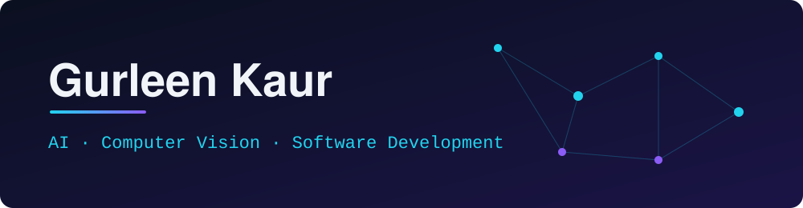

 

**Building intelligent, accessible software where AI meets human experience.**

 

---

## ✦ About Me

I'm an Artificial Intelligence & Machine Learning graduate (B.Tech, 2022–2026) who enjoys turning ideas into practical, usable software. My interests sit around **computer vision**, **artificial & intelligence**, and **modern frontend development**, and I like building things that help real people.

Alongside my technical work, I've spent time in operations and team coordination: leading a small team, running day-to-day workflows, and communicating with clients. That mix helps me work well across both the technical and the human side of a project.

> I'm open to conversations about AI/ML, frontend and full-stack development, and collaborative projects.

---

## ✦ Quick Profile

<table align="center">
  <tr>
    <td align="center" width="25%"><b>🎓 Education</b> B.Tech in AI & ML CGPA 8.25 · 2022–2026</td>
    <td align="center" width="25%"><b>🏢 Internship</b> C-DAC Mohali AI with Computer Vision</td>
    <td align="center" width="25%"><b>🛠️ Projects</b> AI-powered apps Accessibility · IoT · CV</td>
    <td align="center" width="25%"><b>🏆 Hackathon</b> 2nd Place GNA Hackathon 2.0</td>
  </tr>
</table>

---

## ✦ Technical Skills

<b>Programming & Web</b>

 

Python · C++ · R · JavaScript · HTML · CSS · TypeScript · React.js · Vite · Tailwind CSS · FastAPI · MERN fundamentals

<b>AI & Machine Learning</b>

 

Machine Learning · Computer Vision · OpenCV · YOLOv5 · Scikit-learn · OCR (EasyOCR)

<b>Tools & Platforms</b>

 

Git · GitHub · Jupyter Notebook · Tableau · Excel · Notion · Trello · Google Workspace · Arduino IDE

<b>Professional Skills</b>

 

Team leadership · Event coordination · Stakeholder communication · Operations management · Relationship building · Process optimization · Problem-solving

---

## ✦ Featured Projects

<table>
  <tr>
    <td>
      <h3>🧠 LexiLearn.ai</h3>
      <b>AI-Powered Learning Assistant for Dyslexic Students</b>
      
<b>Problem:</b> Students with dyslexia often need reading support that adapts to them.

      
<b>What it does:</b> A learning accessibility platform offering personalized reading assistance and intelligent tutoring.

      <ul>
        <li>OCR-based text extraction</li>
        <li>Text-to-speech functionality</li>
        <li>Multiple AI provider integrations</li>
        <li>Gamified learning and customizable accessibility settings</li>
      </ul>
      
<b>Stack:</b> React.js · TypeScript · Vite · Tailwind CSS · FastAPI · Python · MongoDB · JWT · OpenRouter · Google Gemini · Groq · Ollama · EasyOCR · gTTS · Scikit-learn

      <!-- TODO: Uncomment and replace with your real links.
      
      
      -->
    </td>
  </tr>
  <tr>
    <td>
      <h3>🌾 Agro Intruder Alert System</h3>
      <b>IoT + AI farm security</b>
      
<b>Problem:</b> Farms need timely, automated awareness of unwanted intrusions.

      
<b>What it does:</b> An AI-powered security solution using image processing and IoT.

      <ul>
        <li>Real-time intruder detection with YOLOv5 object detection</li>
        <li>Image processing with OpenCV</li>
        <li>Automated alert generation</li>
        <li>Integration with ESP8266 (NodeMCU)</li>
      </ul>
      
<b>Stack:</b> Python · OpenCV · YOLOv5 · ESP8266 (NodeMCU) · Arduino IDE

      <!-- TODO: Uncomment and replace with your real links.
      
      
      -->
    </td>
  </tr>
  <tr>
    <td>
      <h3>📋 Customer Experience & Feedback Management</h3>
      <b>Client engagement and workflow system for a startup</b>
      
<b>Problem:</b> Startups need consistent client communication and a clear way to learn from feedback.

      
<b>What it does:</b> A structured engagement and workflow management solution to improve communication and service delivery.

      <ul>
        <li>Client onboarding and follow-up workflows</li>
        <li>Project and task tracking</li>
        <li>Customer feedback collection</li>
        <li>Reporting and collaboration processes</li>
      </ul>
      
<b>Tools:</b> Google Forms · Excel · Google Workspace · Notion

      <!-- TODO: Add a link only if you have a public write-up or repository. -->
    </td>
  </tr>
</table>

More of my work: <a href="https://github.com/Gurleen-66/portfolio">portfolio repository</a>

---

## ✦ Experience & Journey

<table>
  <tr>
    <td width="26%"><b>Jan 2026 – Jul 2026</b></td>
    <td>
      <b>C-DAC, Mohali</b> — Intern, Foundation of AI with Computer Vision using Python 
      • Collaborated with multidisciplinary teams to evaluate AI-powered visual intelligence models 
      • Supported technical documentation, cross-team communication and project workflows 
      • Communicated analytical insights during review meetings
    </td>
  </tr>
  <tr>
    <td><b>Aug 2024 – Feb 2025</b></td>
    <td>
      <b>Vrocus Creative Agency</b> — Operations Lead 
      • Managed daily operations and client–team coordination 
      • Coordinated meetings, networking sessions and business collaborations 
      • Led a small team, delegated tasks and supported timely delivery 
      • Used Google Workspace, Notion, Trello and Microsoft Office to streamline workflows
    </td>
  </tr>
  <tr>
    <td><b>Jun 2024 – Aug 2024</b></td>
    <td>
      <b>Ryazio Technologies LLP, Ludhiana</b> — MERN Stack Trainee 
      • Developed responsive frontend interfaces and user-friendly web experiences 
      • Worked with structured components, task management and delivery deadlines
    </td>
  </tr>
</table>

---

## ✦ Achievements

<table align="center">
  <tr>
    <td align="center" width="33%"><b>🥈 2nd Place</b> GNA Hackathon 2.0 Cyber Spark</td>
    <td align="center" width="33%"><b>⚡ Participant</b> BharatTech 2.0 30-hour national-level hackathon</td>
    <td align="center" width="33%"><b>🎖️ NCC 'C' Certificate</b> Grade A</td>
  </tr>
</table>

---

## ✦ GitHub Analytics

These cards are generated by third-party services and update on their own schedule. If one doesn't load, it's the service, not the profile.

<!-- Fallback if the services above are down:

-->

---

## ✦ Contribution Snake

<!-- Enable AFTER the workflow in .github/workflows/snake.yml has run once and created the "output" branch.

  <picture>
    <source media="(prefers-color-scheme: dark)" srcset="https://raw.githubusercontent.com/Gurleen-66/Gurleen-66/output/github-snake-dark.svg" />
    
  </picture>

-->

---

## ✦ Currently Exploring

- 🔍 **Computer vision** — evaluating and applying visual intelligence models
- ♿ **Accessible educational technology** — tools that make learning more inclusive
- 🎨 **Modern frontend development** — React, TypeScript and Tailwind CSS
- ⚙️ **Practical software engineering** — building AI features into usable products

---

## ✦ Let's Connect

I'm always happy to talk about AI, accessible technology, or collaborating on something useful.

 

  
  Thanks for stopping by.

